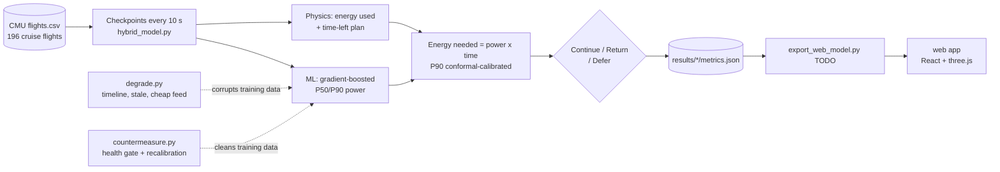

# Case-a-thon playbook

Our shared plan for the W&M AI Case-a-thon 2026, "Unintentional Data Poisoning". It covers what the judges need to see, what we've built, what's left, and how the demo should go. Update the status columns as things land.

Deadline: ____ · Presentation: 10 minutes, built around a live demo · Team: Evan, Luke

---

## 1. The story in one breath

> A delivery drone checks mid-flight: *"Do I have enough battery to finish, or should I come home?"* An AI predicts the energy needed. As its training data quietly goes stale and a cheap sensor feed floods in, the AI keeps sounding confident. It even looks *better*, with fewer aborts, while its safety margin disappears and it starts telling drones to keep flying when they can't make it. We show why that happens, and we build a fix that restores the margin without grounding the fleet.

**Core question (from the prompt):** *When does more information make an AI-enabled decision worse, and what evidence shows our fix restores useful performance?*

**Our answer so far:** more data hurts when it is **biased and plentiful**, or when it **stops being refreshed** while operations change. The model learns the majority source, not the truth. A placebo test shows volume alone does no harm. The bias does.

### What's real and what's simulated (say this plainly)

The CMU dataset has **one** current sensor (a Mauch PL-200) on one drone. There is no cheap sensor, no second feed, no upload outage and no fleet history in it. We create those by corrupting copies of the real readings in `scripts/degrade.py`. For example, the cheap feed is `real current × 0.88 + random noise`, logged twice as often. The "good sensor" is the original, untouched data.

| Real (from CMU) | Simulated by us |
|---|---|
| All 196 flights: position, wind, voltage, current | The cheap sensor feed and its 12% error |
| Payload, speed and altitude settings | The 8-window timeline where packages get heavier |
| Energy actually used (the ground truth we score against) | The upload outage (stale data) |
| | Reference flights logged by both sensors. Both versions of every flight exist, so the fix can compare them; in real life this means flying some flights with both sensors attached |
| | The battery budgets (no real flight came close to empty) |

**Why it's allowed:** the prompt says "Teams may add controlled defects in offline experiments to stand in for accidental real-world failures," and it accepts a simulated timeline when it's clearly labelled. The upside is that we know the true answer for every flight, so we can measure exactly how much the poisoning hurts and how much the fix recovers.

**In the presentation:**
- **Say:** "We injected a simulated faulty sensor feed into real flight data."
- **Never say** that the CMU drones had a bad sensor, or that this happened in a real fleet.
- **In the app:** label the cheap feed, the timeline, the outage and flight 900 as **SIMULATED**.
- **If asked** "how do you know a real cheap sensor fails this way?": we tested several failure shapes (reading low, reading high, an error that grows over time, a fixed offset). Real sensors could still fail in other ways. That goes in the limits.

---

## 2. What the judges score: requirement checklist

Status: ✅ done · 🟡 partly done · ⬜ not started

| # | Requirement | What we show | Where | Status |
|---|---|---|---|---|
| 1 | **Define the decision** | User: drone ops operator. Decision: continue or return, made at 10 s checkpoints. AI: hybrid energy model. Cost of an error: unsafe continue (battery failure) vs needless abort (lost delivery). Unit: one flight. "Better" means fewer unsafe continues without more needless aborts | `results/baseline/README.md` | ✅ (needs a slide) |
| 2 | **Reference baseline** | Clean model: 0.36 Wh MAE, P90 calibrated to 92%, chronological split by flight, 5 seeds, bootstrap CIs | `results/baseline/` | ✅ |
| 3 | **Degradation: stale, low quality, both** | Stale = log uploads stop. Low quality = cheap feed reading 12% low at 2× the record rate. Both. Plus a modification log | `results/degradation/` | ✅ |
| 4 | **Effect over time** | 8-window simulated timeline, clearly labelled. Tracks data age, low-quality share and volume alongside MAE, coverage and decisions | `results/degradation/per_window.csv` | ✅ (needs a chart) |
| 5 | **Explain the mechanism** | Dose-response, unbiased-noise placebo, power/time error split (the ML side breaks, not physics), payload breakdown, stage comparison | `results/degradation/README.md` | ✅ |
| 6 | **Countermeasure** | Same evaluation cases, with and without the fix, on ordinary conditions *and* four unseen defects | `results/countermeasure/` | ✅ |
| 7 | **Limits and next steps** | At least one failure or tradeoff. Stop / iterate / pilot criteria. A bounded next action with a named role and a decision checkpoint | `results/countermeasure/README.md` (failures and tradeoffs) | 🟡 pilot criteria and next action still to write |

**Minimum comparison grid** (the prompt requires all 8 cells):

| | Reference | Stale | Low quality | Combined |
|---|---|---|---|---|
| Without fix | ✅ | ✅ | ✅ | ✅ |
| With fix | ✅ | ✅ | ✅ | ✅ |

**Measurements the prompt asks for** (section "What to measure and report"):

- [x] Task metric with units and results by time window (MAE in Wh, per window)
- [x] Degradation without the fix
- [x] Degradation **with** the fix, and what it recovers
- [x] Confusion counts with a defined positive class ("should return")
- [x] Usefulness and coverage: data discarded (0), decisions deferred (9–12%, 24% in the failure case), rare-event effects (the 750 g flight, the long R6 route)
- [ ] Time and workload: model latency (✅ about 0.02 ms) **separately from** human review time (⬜ time a walkthrough)
- [x] Cost and uncertainty: seed spread, bootstrap CIs (⬜ compute and tool cost line)

**Deliverables:**

- [ ] **Working web app**: algorithm, degradation and countermeasure, plus setup instructions, dependencies, versions and settings
- [ ] **Recorded fallback demo** (a video, in case the live demo breaks)
- [ ] **Results and data manifest**: machine-readable results ✅, plus source/version, subset rules, dates or simulated time, split rules and modification log (✅ mostly; needs one consolidated `MANIFEST.md`), and an **AI/prompt disclosure** ⬜
- [ ] **10-minute presentation** built around the live demo

**Human oversight** (must be *visible* in the demo):

- [ ] Who uses the output: the drone ops operator
- [ ] Who reviews questionable results: a flight lead or data-quality owner
- [x] When the system must defer, with explicit triggers (section 4)
- [ ] How a person corrects an error: override, then log, then the flight is excluded or relabelled at the next retrain
- [ ] **A walkthrough of one unreliable-output scenario** showing the evidence, age/quality information, explanation and correction path the user sees

**Governance** (one slide):

- [ ] Who owns data quality and model performance in a pilot
- [ ] How updates and failures are logged
- [ ] What approvals are needed
- [ ] When the system should **not** be used

---

## 3. What we've found (talking points)

1. **The AI adds real value.** Physics alone (recent power × time left) is off by 8.6 Wh during the climb, mostly too low. Its safety margin has to be so wide that it aborts every flight. The hybrid's error is 0.36 Wh.
2. **Poisoning hides behind good-looking numbers.** In the combined condition, needless aborts *drop* from 65 to 39, so the system looks better, while unsafe continues go from 0 to 4. The P90 still claims 90% confidence but holds only 51% of the time, and 34% by the last window.
3. **The bias causes the harm, not the volume.** As the cheap feed's share goes 0 → 75%, MAE goes 0.34 → 0.75 Wh. The same volume of unbiased noise leaves it flat at 0.35.
4. **The ML half breaks, not the physics half.** The power-prediction error goes from −1.6% to −6.1%, while the time-plan error holds at about +2%.
5. **Harm lands on the newest kind of work.** Bias is −1.02 Wh on 500 g flights against −0.23 Wh on empty ones, because the heavy flights only arrive through the bad feed.
6. **Stale data alone is wasteful rather than dangerous for the hybrid.** The physics anchor keeps it honest, but needless aborts rise from 65 to 97. Pure ML degrades more under stale data (0.49 → 0.72 Wh).
7. **The training stage is where it bites.** Feeding biased *live* telemetry to a clean model barely matters, because the go/no-go call happens at the first checkpoint.
8. **Boundary:** unsafe continues stay rare (4 of 386) because most flights are far from the budget. The poisoning mostly removes the margin rather than flipping decisions. Say this up front: the prompt rewards honest limits.
9. **The fix restores the margin.** In the combined condition, P90 coverage goes 51% → 92%, MAE 0.84 → 0.41 Wh and unsafe continues 4.0 → 0.4. Clean data is unaffected: 0.39 Wh, aborts 65 → 66, health green in every window.
10. **It holds on defects it wasn't designed for:** a 20% bias, a drifting bias, an offset error and an over-reading feed all land at 0.41 Wh and 92–93% coverage. An over-reading feed makes the unprotected system ground 145 flights it could have finished; with the fix, 78.
11. **The fix has a price and a weak spot.** It needs reference flights (about 12% of flights, dual-logged). Without them it can only fall back on the operator: 174 deferrals and 100 aborts. It also lowers P90 coverage on the one 750 g flight in clean conditions (90% → 61%).

---

## 4. The countermeasure (built ✅)

Code: `scripts/countermeasure.py`, `scripts/run_countermeasure.py`. Results and the full write-up are in `results/countermeasure/README.md`. Two layers, each aimed at one link in the chain:

```
data age/quality ──▶ model learns wrong power ──▶ overconfident P90 ──▶ wrong continue call
      ▲ Layer 1: data health gate                    ▲ Layer 2: trusted calibration + operator review
```

**Layer 1: data health gate (before retraining).**
- **Reference flights.** 3 per window (about 12%) are logged by both the accurate logger and the cheap feed, and uploaded manually, so they keep arriving during an outage. Their accurate record is trusted training data.
- **Source audit.** For each window, compare the cheap feed's energy with the accurate logger's on that window's reference flights (95% t-interval). If it's clearly off 1, **recalibrate** those records. If it's consistent with 1, **keep** them. Otherwise, **weight them 0.2** (unverified). Nothing is discarded.
- **Freshness check.** Track how old the newest automatic upload is, and flag an outage.

**Layer 2: decision safeguards.**
- **Trusted calibration.** The P90 is calibrated on held-out recent trusted flights (reference flights and accurate-logger flights), never on the cheap feed.
- **Health badge.** Red when unverified records carry more than 10% of the training weight. Amber when the feed was recalibrated, the upload is stale, or there's nothing trusted to calibrate on. Green otherwise.
- **CONTINUE / RETURN / DEFER.** Defer when the P50–P90 band straddles the budget. When health is red, also defer a continue with less than 1 Wh to spare. Deferred flights are scored as returned (the safe choice) and counted as operator workload.

**Against the targets:**

| Target | Result |
|---|---|
| Combined P90 coverage back near 90% | ✅ 51% → 92% |
| Unsafe continues back to 0 | 🟡 4.0 → 0.4 (about 2 events across 5 seeds) |
| Needless aborts ≤ 97 (stale level) | ✅ 76 (clean level: 65) |
| No harm on clean data | ✅ 0.39 Wh, aborts 65 → 66 |
| Holds on unseen defects | ✅ 20% bias, drifting bias, offset, over-reading |
| Show a failure | ✅ no reference flights → coverage only 63%, or 174 deferrals |

**Changed from the original plan** (be ready to explain why):
- **Calibration also uses accurate-logger flights, not only reference flights.** With only 9 reference flights, the margin was noisy and aborts rose without reason.
- **The amber health level no longer triggers extra deferrals.** In the first version, deferring every near-miss continue under amber pushed aborts to 112 in the combined condition, above the target.
- **The real Sep–Oct period is not tested with the fix yet.** The unseen conditions are all simulated defects.

## Next step: wire it into the app

1. ✅ **Live mission check in the app** for the clean model (`scripts/export_web_model.py`, `web/src/ui/Mission.tsx`).
2. ✅ **Poisoning lab** (scenario switcher, fix toggle, health rows, window charts, demo buttons): `scripts/export_web_scenarios.py` (`npm run scenarios`) and `web/src/ui/Lab.tsx`. The best demo is flight 268 at 28.5 Wh. Under "Both" with the fix off, it says continue, then "Committed: tight", and the hindsight says "Missed" (0.15 Wh short). With the fix on, it says "Too close to call" at 0:20 and sends it to the operator, the badge turns amber, and the panel reads "cheap feed reads ×0.88: 1022 records recalibrated". Honest caveat: decision flips are rare and small (the poisoning mostly removes the margin), so lean on the charts (P90 holds 43% vs 88% with the fix in window 5) and the "actual" line.
3. **Operator walkthrough with a timer** (section 5, item 5). That gives our human-effort number.
4. **Requirement 7 text**: pilot criteria and the bounded next action (section 9).

---

## 5. Shaping the product: the demo app

**Principle:** the app *is* the presentation. Every claim on a slide should be something a judge can see happen in the app. Model results are **precomputed in Python and exported as JSON**. The browser only plays them back, which keeps the demo fast and reliable. The prompt says we don't need to run a model live.

### What exists now

A 3D replay of each CMU flight in `web/`: React 19, three.js via React Three Fiber, Zustand and Vite, deployed to Cloudflare Workers. It has a flight picker, a 3D path coloured by power, grid and terrain map layers (the Google photo layer was removed), telemetry, a playback scrubber, and simulated failure flight 900. It uses a graphite-and-ultraviolet dashboard theme with Orbitron headings (see `web/README.md`, "Look").

### Live mission check (built ✅)

As any flight plays, the app decides in real time whether the drone will make it or should turn back. It covers all 196 real route flights plus simulated flight 900. It was tested in the browser at desktop (1440×900), laptop (1280×800, 1000×820) and phone (375 wide) sizes, and the production build passes.

**What you see.** A **Mission check** panel sits top-left, above the telemetry:
- **The call, live:**
  - **On track** (green): even the cautious P90 forecast fits the battery.
  - **Turn back** (red): even the median forecast doesn't fit.
  - **Too close to call** (amber): the P50–P90 band straddles the battery, so it goes to the operator and is scored as a return.

  The call only counts before halfway round the route. After that it switches to **Committed**, because finishing the loop is the quickest way home.
- **Energy gauge:** used, forecast, and the P90 margin (red when it's over the battery line).
- **Forecast chart:** the total-mission forecast over the flight against the battery line, zoomed to the band around the battery. Click to scrub.
- **Battery slider:** the usable energy for this mission (12–36 Wh, default 20). The call updates instantly, and the value is remembered between visits.
- **Hindsight line:** compares the call with what the flight really used ("Right call", "Missed" or "Cautious"). It appears automatically after landing.

**Everywhere else:**
- The timeline shades the decision window and flags the call.
- The route map marks halfway (½) and where the call was made.
- The drone's reticle and ground ring turn amber or red.
- Hover tests show "Not rated", since they have no route.

**Demo moments:**
- **Flight 142 at 20 Wh:** "Turn back" at 0:19. Drag the battery to 24 Wh and it flips to "On track". The hindsight confirms both calls were right (21.2 Wh really used).
- **Flight 900 (simulated battery failure):** the check calls for a return at 0:19, **72 s before the simulated pack cuts out**. Its battery is fixed at 11.8 Wh (the slider is locked), and the hindsight says the full mission takes 21.2 Wh, 9.4 Wh more than the pack had.

**How it works:**
- `scripts/export_web_model.py` (`npm run model`, about 10 s) uses the same hybrid model as `results/`.
- It writes `web/public/data/model/index.json` plus one file per flight: energy used, and the P50/P90 still needed, once per second.
- **Every flight is scored by a model that never saw it.** Flights are split into 5 groups by flight day, and each group is forecast by a model trained on the other four. Out of sample, forecasts are off by 0.38 Wh on average, and the P90 holds 95% of the time.
- Flight 900 reuses flight 142's forecast, since the path and sensors are the same, up to the moment its pack cuts out.
- The browser makes the call from those numbers and the slider, in `web/src/mission.ts`. The panel is `web/src/ui/Mission.tsx`.

**Not done yet:**
- Switching between the poisoned and fixed scenarios in the app (items 2–4 below).
- At about 1000 px wide, the playback timeline gets very narrow. This predates the mission check.

### What to add (priority order)

1. ✅ **AI decision panel**, on the flight being replayed:
   - a gauge of energy needed (P50 with a P90 band) against energy left, with the budget line;
   - a big status: **CONTINUE**, **RETURN** or **DEFER TO OPERATOR**;
   - when the call was made, and how much margin was left.
2. **Scenario switcher**: Reference / Stale / Low quality / Combined, plus a **Countermeasure on/off** toggle. Switching conditions on the same flight is the demo's key moment: the same drone, the same flight, a different answer.
3. **Data health badges**: age of the newest trusted data, the cheap feed's share of training data, the result of the bias audit, and recent calibration (P90 coverage on reference flights). Show them green, amber or red.
4. **Timeline view**: windows 1–7 on the x-axis. Lines for MAE and P90 coverage, a shaded area for the low-quality share, and markers for unsafe continues. A toggle for with/without the fix. This answers requirement 4 at a glance.
5. **Operator walkthrough** (requirement for human oversight): one flight where the system defers. The operator sees the evidence (prediction band against budget), the age/quality information (badges), a plain-English explanation (e.g. "trained mostly on an unverified sensor feed; recent accuracy 51%"), and actions (**Return now / Continue with override / Flag data source**). The override is logged. Time this walkthrough: it's our human-effort number.
6. **Mechanism page or slide**: the dose-response vs placebo chart, and the power/time error split.

### Data contract (Python → app)

Add `scripts/export_web_model.py`, writing `web/public/data/model/`:

- `timeline.json`: per condition × fix on/off × window: MAE, coverage, unsafe, aborts, low-quality share, data age.
- `flights/<id>.json`: per condition × fix on/off: the checkpoint list `{t, e_used, e50, e90, decision, health}`, plus the flight's call and outcome.
- Keep files small and use the same `flight` ids as `web/public/data/flights/`.

### Credibility rules for the UI

- Anything simulated gets a visible **SIMULATED** label: the timeline, the cheap feed, the outage, flight 900.
- Never imply battery aging, fleet drift or a real commercial fleet.
- Show uncertainty (P90 bands), not just point estimates.

---

## 6. How it's built (architecture)



| Piece | File | Status |
|---|---|---|
| Data exploration | `scripts/explore_cmu_drone.py` → `results/exploration/` | ✅ |
| Hybrid model, decision rule, metrics | `scripts/hybrid_model.py` | ✅ |
| Clean baseline | `scripts/run_baseline.py` → `results/baseline/` (~1 min) | ✅ |
| Defects and simulated timeline | `scripts/degrade.py` | ✅ |
| Degradation grid and mechanism checks | `scripts/run_degradation.py` → `results/degradation/` (~9 min) | ✅ |
| Countermeasure | `scripts/countermeasure.py`, `scripts/run_countermeasure.py` → `results/countermeasure/` (~4 min) | ✅ |
| Export for the app | `scripts/export_web_model.py` (`npm run model`, ~10 s), `scripts/export_web_scenarios.py` (`npm run scenarios`, ~2 min) | ✅ |
| Web replay | `web/` (see `web/README.md`) | ✅ replay, live mission check and poisoning lab; 🟡 operator walkthrough not started |
| Manifest and AI disclosure | `MANIFEST.md` | ⬜ |

**Key design decisions** (and why, for judge questions):
- **Hybrid over pure ML:** more accurate (0.36 vs 0.46 Wh) and more robust when data is stale (0.47 vs 0.72 Wh).
- **Gradient boosting over Random Forest or a Decision Tree:** we tested all three on the same splits. Boosting wins (0.36 / 0.40 / 0.47 Wh).
- **Split by whole flight and by date.** A random row split would inflate the score (R² 0.994 → 0.996) by testing on flights the model has partly seen.
- **P90 rule, not P50:** a too-low guess means battery failure, which is worse than a needless abort.
- **Return calls count only before halfway**, because routes are loops back to launch.
- **Energy budget is simulated:** real flights used 13–38 Wh of a 100 Wh pack and never came close to empty.

---

## 7. The 10-minute demo script (draft)

| Time | Beat | On screen |
|---|---|---|
| 0:00–1:00 | **The decision.** A drone, a package, a battery. "Continue or come home?" Who uses it, and what an error costs | Flight 142 playing; drag the battery from 24 Wh (On track) to 20 Wh (Turn back). Then flight 900: turn back called 72 s before the pack dies |
| 1:00–2:00 | **How the AI works.** Physics + ML, P90 safety margin, why 0.36 Wh is good enough | Architecture diagram, baseline numbers |
| 2:00–4:00 | **Poison it.** Open the lab and press Demo (flight 268, 28.5 Wh, "Both"). The answer still looks confident ("On track", then "Committed: tight"), the health check says "Not monitored", and the hindsight says "Missed". The window charts show the P90 holding only 34–43% of the time | Poisoning lab, mission check |
| 4:00–5:30 | **Why: the mechanism.** Dose-response vs placebo. "It's the bias, not the volume." The ML half broke, not physics. Heavy flights hit hardest | Mechanism chart |
| 5:30–7:30 | **The fix.** Flip the countermeasure switch on the same flight: "Too close to call" at 0:20, sent to the operator, health amber, "cheap feed reads ×0.88: 1022 records recalibrated". The charts switch to the green line (about 90% coverage). Then show the unseen-defect results | Poisoning lab, fix on |
| 7:30–8:45 | **Human in the loop.** A DEFER case: the operator sees the evidence, the badges and the explanation, takes an action, and it's logged. Review time: N seconds | Operator walkthrough |
| 8:45–10:00 | **Limits and next step.** Where the fix fails, what we'd pilot, who owns what, when not to use it | Limits slide |

Rehearse with a timer. Record the fallback video from the final rehearsal.

---

## 8. Questions judges will likely ask

| Question | Our answer |
|---|---|
| Isn't the simulated timeline cherry-picked? | It's labelled as simulated. The prompt allows a labelled simulated progression when there's no long history. We also report the real Jul–Oct drift, and we keep real chronology within each window |
| How do you know it's the bias and not just more data? | The placebo: the same volume of unbiased noisy records changes nothing |
| Did you engineer the win? | We report a boundary: unsafe continues stay rare because most flights are far from the budget. The fix also has a hole we show on purpose: without reference flights it can't measure the bias, so it only partly recovers (63% coverage) or leans on the operator (174 deferrals). It was also tested on four defects it wasn't designed around |
| Why should we trust 196 flights? | Splits keep whole flights together, CIs come from resampling flights, and results are repeated over 5 seeds. We don't claim more than the data supports: one aircraft, mostly one route |
| Why not a deep model? | Too little data. Trees are accurate here and easy to inspect. We tested Random Forest and a Decision Tree as well |
| What does the human actually do? | Section 5, item 5. And we measured how long it takes |
| What would you do next? | [section 9] |

---

## 9. Limits and next action (to finish after the countermeasure)

- **Limits:** a simulated timeline, feed and outage; one aircraft; mostly route R1; budgets chosen by us; small decision counts; no true airspeed or temperature; the anemometer reading mixes wind with the drone's own motion.
- **Stop / iterate / pilot criteria:** e.g. pilot only if the fix holds coverage above 85% under the unseen bias *and* keeps needless aborts within X% of the clean model.
- **Bounded next action:** e.g. "a 2-week shadow-mode pilot on one route. The data-quality owner reviews every deferral. Go/no-go review at the end, with coverage ≥ 85% and zero unsafe continues as the bar."

---

## 10. Guardrails (don't lose points on these)

- Split by **whole flight** and keep chronology. Never shuffle rows.
- Label every simulated element as **SIMULATED**, in results and in the UI.
- Never claim the data measures battery aging, fleet drift or commercial-fleet behaviour.
- Log injected defects **separately** from defects already in the source.
- Fix the seeds, repeat runs, and report the spread.
- No future information in features: everything the model sees is known at the checkpoint time.
- Keep API keys out of the repo (`web/.env.local` is gitignored).
- Credit the dataset: Rodrigues et al., CMU, doi 10.1184/R1/12683453.v1, CC BY 4.0.

---

## 11. Suggested split of work

This is only a suggestion; swap pieces around based on who likes what.

| Track | Pieces |
|---|---|
| **Model and evidence** | ~~Countermeasure, 8-cell grid, unseen conditions~~ ✅ → `export_web_model.py` → `MANIFEST.md` + AI disclosure → requirement 7 text |
| **Product and story** | AI decision panel → scenario switcher → health badges → timeline chart → operator walkthrough (and timing it) → slides → fallback recording |

**Handoff point:** agree on the JSON data contract (section 5) first. The product track can then build the UI against stub JSON while the model track produces the real numbers.

## Run everything

```bash
gunzip -k data/raw/cmu_drone/flights.csv.gz
```
```bash
python3 scripts/run_baseline.py
```
```bash
python3 scripts/run_degradation.py
```
```bash
python3 scripts/run_countermeasure.py
```
```bash
cd web && npm run model
```
```bash
cd web && npm install && npm run dev
```

Requires Python 3.12+ with numpy, pandas and scikit-learn, and Node 22+.
