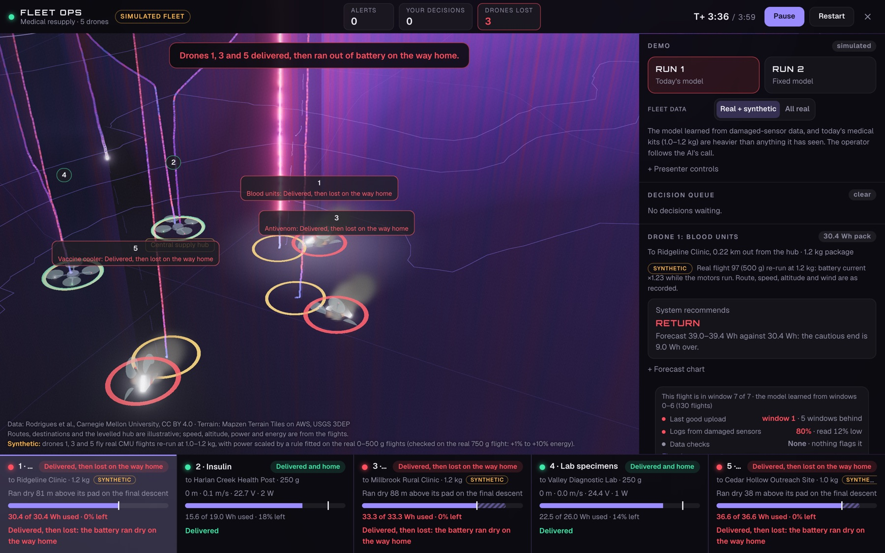
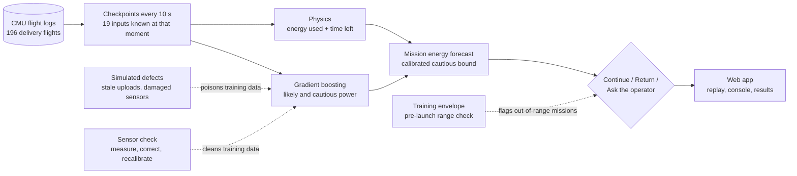
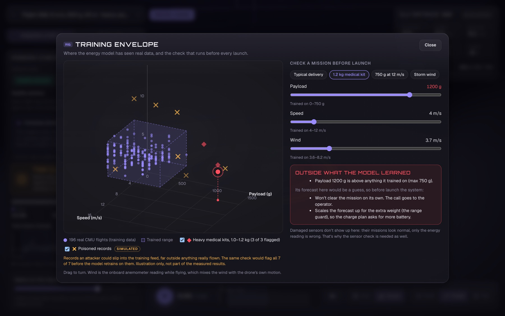
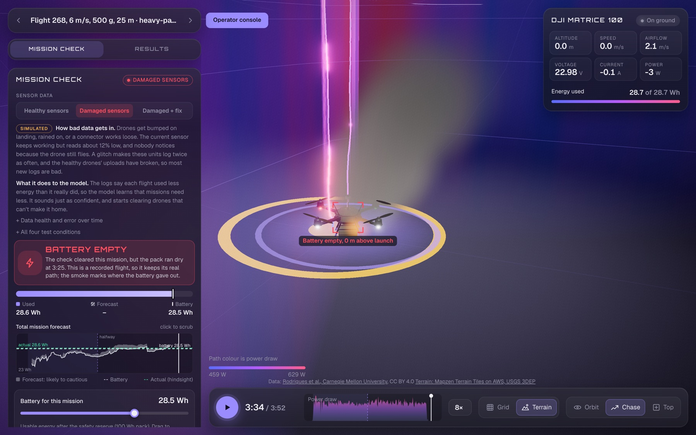
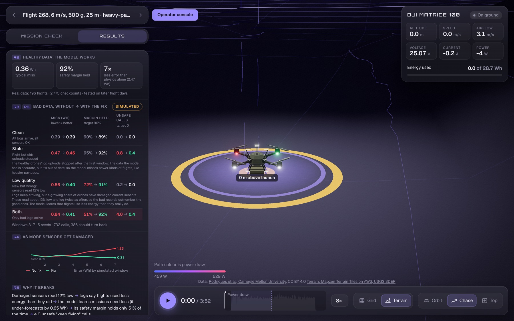

# When Good Data Goes Bad: Drone Energy Forecasting Under Unintentional Data Poisoning

**An energy-forecasting model for delivery drones, a controlled study of how stale and damaged sensor data quietly break it, and a countermeasure that restores it, shown in an interactive 3D operator console.**

Built by **Evan Britton** and **Luke Gravley** for the **William & Mary AI Case-a-thon 2026** ("Unintentional Data Poisoning", case sponsored by Air Combat Command, HQ ACC/ST).

**[▶ Live demo: caseathon.vercel.app](https://caseathon.vercel.app)** · [Results](results/) · [Web app](web/) · [Experiment code](scripts/)



---

## The problem

An AI system that decides whether a drone has enough battery to finish a delivery keeps giving answers that *look* reasonable. But the data it learns from is degrading: some drones' current sensors get bumped or wet and start reading low, and the healthy drones' log uploads silently stop. Nobody notices, because the drones still fly.

**The question:** when does more data make an AI-enabled decision worse, and can we detect and fix it before a drone is lost?

## What we built

| | |
|---|---|
| **A hybrid energy model** | Physics (energy used so far + time left on the route) combined with gradient-boosted quantile regression of future power draw. It gives a likely forecast and a cautious one (90th percentile) at every 10 s checkpoint, and a go / turn-back / ask-the-operator call. |
| **A degradation study** | A simulated 8-window timeline over 196 real flights, testing **stale**, **low-quality** and **combined** training data, each with and without the fix, over 5 seeds. |
| **A countermeasure** | A "sensor check": a few check flights carry a trusted spare sensor, measure how far off the damaged sensors read, and correct the bad records instead of deleting them, before the model retrains and recalibrates on trusted data only. |
| **A training-envelope guard** | A pre-launch check that flags any mission outside the conditions the model was trained on (too heavy, too fast, too windy, or a combination nobody ever flew). |
| **An interactive web app** | A 3D replay of every real flight with the live mission check, a five-drone operator console with human-in-the-loop decisions, a results scorecard and a 3D view of the training envelope. |

## Key results

**The model works on healthy data.** On flights it never saw (chronological, whole-flight splits):

| Model | Average error | Safety margin held (target 90%) |
|---|---|---|
| Physics only | 2.47 Wh | 90%, but only by being so cautious it aborts every flight |
| Pure machine learning | 0.46 Wh | 89% |
| **Hybrid (ours)** | **0.36 Wh** (about 2% of a typical 21 Wh mission) | **92%** |

**Bad data breaks it quietly, and the fix restores it.** Windows 3–7, 5 seeds, 732 battery decisions, 386 of which should have been "turn back". Each cell reads *without fix → with fix*:

| Training data | Average error (Wh) | Safety margin held | Unsafe "keep flying" calls per run |
|---|---|---|---|
| Clean | 0.39 → 0.39 | 90% → 89% | 0.0 → 0.0 |
| Stale (uploads stopped) | 0.47 → 0.46 | 95% → 92% | 0.8 → 0.4 |
| Low quality (sensors read 12% low) | 0.56 → 0.40 | 72% → 91% | 0.2 → 0.0 |
| **Both** | **0.84 → 0.41** | **51% → 92%** | **4.0 → 0.4** |

- **The poisoning is invisible from the outside.** With both defects, the model still claims 90% confidence but is right only 51% of the time (34% by the last window), and nothing flags it.
- **It's the bias, not the volume.** Raising the damaged-sensor share from 0% to 75% doubles the error (0.34 → 0.75 Wh). Adding the same volume of *unbiased* noise leaves it flat (0.35 Wh).
- **The fix generalizes.** It also handled four sensor faults it wasn't designed for (reading 20% low, a drifting bias, a fixed offset, reading 10% high), landing at 0.41 Wh and a 92–93% margin every time.
- **It has an honest limit.** Without check flights it can't measure the error: the margin only recovers to 63%, and 174 calls fall to the operator. The cost is about 12% of flights carrying a spare sensor.

Full write-ups: [baseline](results/baseline/README.md) · [degradation](results/degradation/README.md) · [countermeasure](results/countermeasure/README.md) · [data exploration](results/exploration/README.md).

## How it works



### The model

At every checkpoint the model sees 19 inputs, all known at that moment: the mission plan (payload, planned speed, target altitude, planned time), wind speed and direction relative to the drone, where it is now (time and distance flown and left, altitude, climb rate, ground speed, flight phase), and the battery (energy used, recent power draw, voltage).

- **Machine learning** (scikit-learn `HistGradientBoostingRegressor`, quantile loss at 50% and 90%) predicts the power draw for the rest of the mission.
- **Physics** estimates the time left from the route and planned speed.
- Energy still needed = predicted power × time left. The cautious bound is conformally calibrated on the most recent training flights so it really covers about 90% of cases.
- **Decision rule:** continue if *energy used + cautious energy still needed ≤ battery*; turn back if even the likely forecast doesn't fit; otherwise ask the operator. A return call only counts before the halfway point, because routes are loops.

### The degradation study

| Condition | What happens | Real-world failure it stands for |
|---|---|---|
| Stale | The healthy drones' log uploads stop after window 1; the model keeps retraining on old, mostly light-package flights | A log-upload job that silently stops |
| Low quality | A growing share of drones (0% → 90%) have damaged current sensors that read 12% low and log twice as often | A fast, low-quality feed that outnumbers an accurate one |
| Both | Uploads stopped *and* sensors damaged, so every recent record is wrong | Both at once |

The model retrains at the start of every window on everything it has received, and is always tested on the clean recordings. Splits keep whole flights together and preserve chronology; no future information reaches the model.

### The countermeasure

```
error ratio      = damaged sensor's reading ÷ trusted spare sensor's reading   (on the check flights, ≈ 0.879)
corrected energy = recorded energy ÷ error ratio                                (≈ recorded energy × 1.14)
```

Each window, the check flights measure the error ratio with a 95% confidence interval. If it's clearly off, the records are corrected (none deleted); if it's inconclusive, they're kept at reduced weight. The model then retrains, and its safety margin is calibrated on trusted flights only. A data-health badge and operator review cover the close calls.

### The training envelope



The model is only trusted inside the conditions it was trained on: payload 0–750 g, speed 4–12 m/s, wind 3.6–8.2 m/s. Before launch, a mission is flagged if any condition is outside that range, or if no real training flight flew a similar combination (which catches empty corners such as 750 g at 12 m/s). Flagged missions go to the operator instead of being cleared automatically.

## The app

**[caseathon.vercel.app](https://caseathon.vercel.app)** opens on a real heavy-payload flight with a 28.5 Wh battery.



- **Mission check (replay):** switch between *Healthy sensors*, *Damaged sensors* and *Damaged + fix* on the same real flight. Before takeoff, the healthy model says "too close to call", the poisoned model clears it, and the fixed model sends it back to the operator. The battery really runs dry at 3:25.
- **Operator console:** five medical-supply drones flown at once. Run 1 uses today's poisoned model; Run 2 uses the fixed model, which proposes a pre-launch charge plan that a person approves. The console logs every human decision and how long it took, and can pause the clock whenever the AI asks for a call.
- **Results tab:** every headline number, mapped to the case requirements.



## Repository layout

```
├── data/raw/cmu_drone/      CMU flight logs (CC BY 4.0), compressed, plus the dataset's own README
├── scripts/                 Python: model, degradation, countermeasure, experiments, web exports
│   ├── hybrid_model.py      checkpoints, hybrid model, decision rule, metrics
│   ├── degrade.py           simulated timeline and defects
│   ├── countermeasure.py    sensor check, correction, trusted calibration, health badge
│   ├── run_*.py             baseline, degradation grid and countermeasure experiments
│   └── export_web_*.py      JSON for the web app
├── results/                 metrics, per-window tables, modification log and write-ups
├── web/                     React + three.js app (see web/README.md)
└── docs/images/             screenshots
```

## Running it

**Experiments** (Python 3.9+):

```bash
pip install -r requirements.txt
```

```bash
gunzip -k data/raw/cmu_drone/flights.csv.gz
```

```bash
python3 scripts/run_baseline.py
```

```bash
python3 scripts/run_degradation.py
```

```bash
python3 scripts/run_countermeasure.py
```

The baseline takes about a minute, the degradation grid about 9 and the countermeasure about 4. Seeds are fixed, so the numbers above reproduce.

**Web app** (Node 22+):

```bash
cd web && npm install && npm run dev
```

The app reads precomputed JSON from `web/public/data/`, so it runs without Python. To regenerate that data or deploy, see [web/README.md](web/README.md).

## Tech stack

**Modeling:** Python, pandas, NumPy, scikit-learn (histogram gradient boosting, quantile regression), split-conformal calibration, bootstrap confidence intervals.
**App:** TypeScript, React 19, three.js via React Three Fiber, Zustand, Vite. Deployed on Vercel.

## Honest limits

- **Simulated parts are labelled.** The timeline, damaged sensors, broken uploads, heavy medical kits, fleet staging and the "poisoned records" in the envelope view are simulated. The flights, energy readings and model are real.
- **One aircraft, mostly one route.** 196 flights of a DJI Matrice 100 around Pittsburgh. The results don't claim battery aging, fleet drift or commercial-fleet behaviour.
- **No true airspeed, temperature or humidity.** The "wind" input is the drone's own anemometer, which mixes wind with the drone's motion.
- **Unsafe calls are rare even without the fix** (4 of 386 per run). Poisoning mostly erodes the safety margin rather than flipping decisions outright, which is exactly why it goes unnoticed.
- **Only the payload limit is wired into the console's launch check.** The wind and speed limits are shown in the envelope view.

## Credits

- **Data:** T. Rodrigues et al., *Data Collected with Package Delivery Quadcopter Drone*, Carnegie Mellon University, [doi:10.1184/R1/12683453.v1](https://doi.org/10.1184/R1/12683453.v1), CC BY 4.0. Terrain tiles: Mapzen Terrain Tiles on AWS, USGS 3DEP.
- **Event:** William & Mary AI Club Case-a-thon 2026, case "Unintentional Data Poisoning", sponsored by Air Combat Command, HQ ACC/ST.
- **Tools:** built with AI pair-programming assistance (Claude Code). The models, experiments and results are our own and reproducible from this repository.

## License

Code: [MIT](LICENSE). The CMU dataset keeps its own CC BY 4.0 license.
